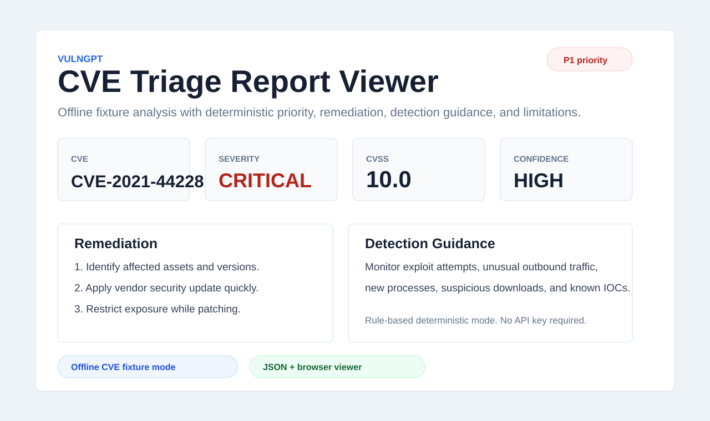

# VulnGPT

[](https://github.com/omobolajiadeyan/vulngpt/actions/workflows/tests.yml)
[](LICENSE)
[](https://github.com/omobolajiadeyan)

VulnGPT is a CVE vulnerability triage assistant. It fetches CVE data from the National Vulnerability Database, parses CVSS/CWE/reference context, and generates an actionable report with heuristic exploitability, active-exploitation status, remediation steps, detection guidance, triage priority, confidence, and limitations.

The core CLI works without API keys through a deterministic rule-based fallback.
Optional Claude/Anthropic analysis can be enabled for narrative enrichment, but
the project is designed to remain demoable and testable offline. The optional
`web/` report viewer is a static TypeScript interface for reviewing exported
JSON in a browser.

## Why This Exists

CVE descriptions often explain what is vulnerable, but not what an analyst should do next. VulnGPT turns CVE metadata into a practical triage report:

- What is affected?
- What do CVSS and public references indicate about intrinsic exploitability?
- Is active exploitation actually confirmed?
- What priority should the issue receive?
- What should defenders monitor?
- What are the limitations of this conclusion?

## For External Reviewers

If you are evaluating this project, start here:

- [External Evaluator Guide](docs/EVALUATOR_GUIDE.md) - five-minute review path, expected outcome, and trust boundaries
- [Project Evidence](docs/PROJECT_EVIDENCE.md) - reproducible offline evidence, viewer path, and limitations
- [Sample Output](docs/SAMPLE_OUTPUT.md) - what the offline demo should produce



Fastest safe demo:

```bash
python3 vulngpt.py CVE-2021-44228 --offline
python3 vulngpt.py CVE-2021-44228 --offline --output report.json
```

The bundled fixture keeps the demo deterministic and does not require network
access or API keys.

## Features

- Fetches CVE metadata from NVD
- Offline fixture mode for deterministic demos and tests
- Parses CVSS v3.1/v3.0, CWE, references, dates, and affected CPEs
- Rule-based CVSS-based exploitability indicators and triage priority
- Optional Claude/Anthropic narrative analysis via `CLAUDE_API_KEY`
- JSON export for tickets, reports, or automation
- Zero runtime dependencies in deterministic mode
- Unit-tested NVD parsing, analysis, and CLI behavior

## Installation

```bash
git clone https://github.com/omobolajiadeyan/vulngpt.git
cd vulngpt
python --version  # Python 3.10+ required
```

Optional local install:

```bash
python -m pip install .
vulngpt CVE-2021-44228 --offline
```

## Usage

```bash
# Demo without network access, using the bundled Log4Shell fixture
python vulngpt.py CVE-2021-44228 --offline

# Fetch from NVD and use deterministic fallback analysis
python vulngpt.py CVE-2023-44487

# Export report to JSON
python vulngpt.py CVE-2021-44228 --offline --output report.json

# Raw JSON output
python vulngpt.py CVE-2021-44228 --offline --json
```

Optional AI-assisted narrative mode:

```bash
export CLAUDE_API_KEY=your-key-here
python vulngpt.py CVE-2021-44228
```

Rule-based mode is preferred for repeatable tests, demos, and CI. AI-assisted mode should not be used with private asset data or customer information.

## Example Output

```text
CVE-2021-44228  |  CRITICAL — CVSS 10.0
Rule-based analysis (set CLAUDE_API_KEY for AI narrative enrichment)

SUMMARY
  CVE-2021-44228 is a CRITICAL-severity vulnerability (CVSS 10.0)
  affecting software systems. CVSS indicators suggest it is remotely
  exploitable, requires no authentication, and needs no user interaction.

EXPLOITABILITY AND ACTIVE EXPLOITATION
  CVSS-based potential : CRITICAL — CVSS base score 10.0 and vector
  CVSS:3.1/AV:N/AC:L/PR:N/UI:N/S:C/C:H/I:H/A:H.
  Active exploitation : UNKNOWN — no KEV lookup or environment telemetry.
  Priority            : P1  |  Confidence: HIGH (CVSS metadata only)

REMEDIATION STEPS
  1. Inventory potentially affected assets and confirm product versions against the vendor advisory.
  2. Apply the vendor security update or upgrade affected instances to a fixed version, prioritizing by this CVSS-based baseline and local exposure.
  3. If patching is delayed, apply vendor-approved mitigations and restrict access to affected components where feasible.
```

## Triage Model

The deterministic fallback reports CVSS-based **heuristic exploitability**, not a
probability of attacks or confirmation of active exploitation. It separates:

- CVSS base score and severity
- CVSS vector signals such as network attack, privileges required, and user interaction
- Public reference tags as references/signals only; even an `Exploit` tag does not
  establish active exploitation
- An `active_exploitation_status` of `UNKNOWN`, because VulnGPT does not query
  CISA KEV or environment telemetry
- Affected product identifiers when available

Baseline priority mapping uses CVSS score (adjust it for asset exposure, controls,
and business criticality):

| CVSS score | Priority |
|---|---|
| `9.0–10.0` | `P1` |
| `7.0–8.9` | `P2` |
| `4.0–6.9` | `P3` |
| `0.0–3.9` | `P4` |
| unavailable/invalid | `UNRATED` |

Confidence describes completeness of the CVSS metadata used for this baseline;
it is not confidence that exploitation is occurring.

Limitations:

- It does not establish whether exploitation is occurring or whether your environment is exposed.
- It does not replace vendor advisories or emergency change control.
- It does not currently ingest EPSS, CISA KEV, asset inventory, or SBOM context.

## Offline Fixtures

Bundled fixtures live in:

```text
data/fixtures/
```

Run with:

```bash
python vulngpt.py CVE-2021-44228 --offline
```

Use a custom fixture directory:

```bash
python vulngpt.py CVE-2021-44228 --offline --fixture-dir ./my-fixtures
```

## Browser Report Viewer

VulnGPT includes a small TypeScript-powered report viewer in `web/`. It turns
exported JSON into a reviewer-friendly summary with severity, exploitation
likelihood, remediation, detection guidance, references, and limitations.

```bash
python3 vulngpt.py CVE-2021-44228 --offline --output web/sample-report.json
cd web
python3 -m http.server 8080
# Open http://127.0.0.1:8080/
```

The viewer is static and local: no backend, no telemetry, and no CVE report data
leaves the browser.

## Architecture

```text
vulngpt/
├── vulngpt.py        # CLI entrypoint and report renderer
├── nvd.py            # NVD API client, fixture loader, and CVE parser
├── analyst.py        # Optional Claude analysis and deterministic fallback
├── docs/             # Evaluator guide, sample output, and evidence notes
├── data/fixtures/    # Offline CVE fixtures for demos and tests
├── web/              # TypeScript report viewer for exported JSON
├── tests/            # Unit tests for parser, analyst, and CLI behavior
└── .github/workflows # CI test workflow
```

## Verification

```bash
python -m unittest discover -s tests -v
python vulngpt.py CVE-2021-44228 --offline --json
```

## Roadmap

- [ ] EPSS probability support
- [ ] CISA KEV enrichment
- [ ] Batch analysis for CVE lists
- [ ] SBOM/package-name matching
- [ ] SARIF or ticket-friendly export format
- [ ] Local LLM/Ollama support for air-gapped environments

## Part of the Security Automation Toolkit

VulnGPT is one piece of a practical security-automation toolkit. The others:

- **[PhishGuard AI](https://github.com/omobolajiadeyan/phishguard-ai)** — explainable offline phishing detection (flagship, on GitHub Marketplace)
- **[Secrets Scanner](https://github.com/omobolajiadeyan/secrets-scanner)** — exposed-credential detection with redacted SARIF/JSON evidence
- **[Log Analyzer](https://github.com/omobolajiadeyan/log-analyzer)** — MITRE ATT&CK-mapped log threat detection
- **[BehaviorSense](https://github.com/omobolajiadeyan/behaviorsense)** — UEBA-style behavioral anomaly detection
- **[CVE Dashboard](https://github.com/omobolajiadeyan/cve-dashboard)** — live NVD vulnerability intelligence

Full portfolio: [github.com/omobolajiadeyan](https://github.com/omobolajiadeyan)

## Author

**Omobolaji Adeyan** - Cybersecurity Engineer  
GitHub: https://github.com/omobolajiadeyan · Website: https://omobolajiadeyan.com

## License

MIT License. See [LICENSE](LICENSE).
